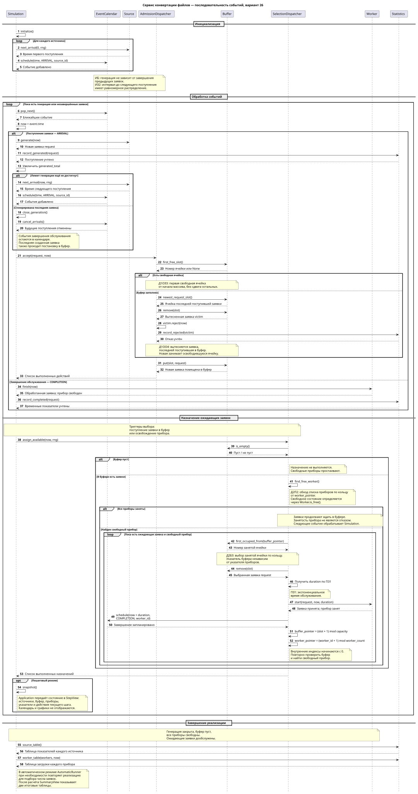
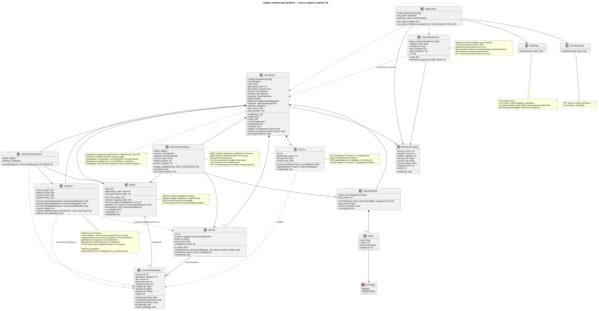
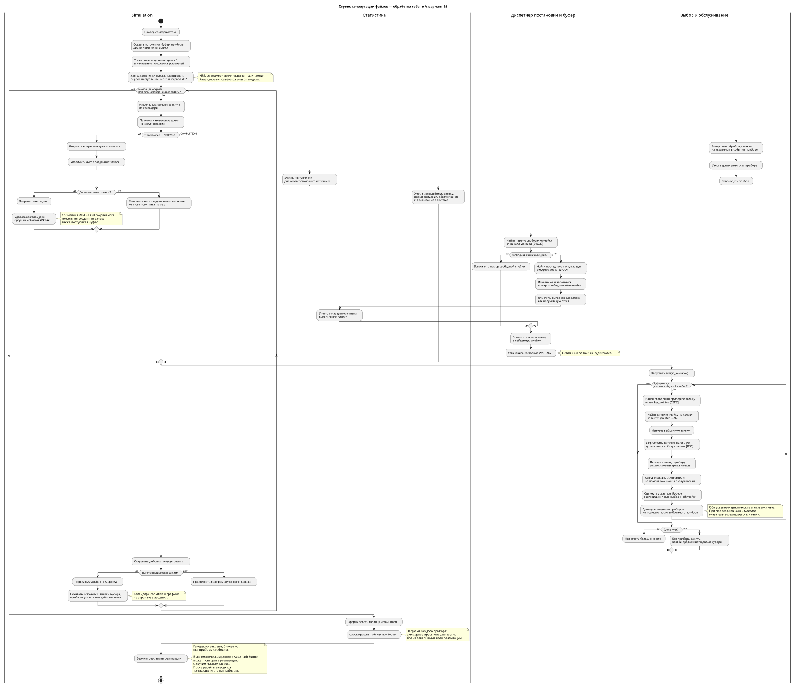

# Сервис конвертации файлов — модель СМО

Учебная имитационная модель системы массового обслуживания.
Вариант 26.

Программа моделирует поступление запросов на конвертацию,
ожидание в ограниченном буфере, обслуживание и отказы.
Реальное преобразование файлов не выполняется.

## Вариант

`ИБ | ИЗ2 | ПЗ1 | Д1ОЗ3 | Д1ОО4 | Д2П2 | Д2Б3 | ОР1 | ОД2`

| Код | Реализация |
| --- | --- |
| ИБ | Источники генерируют заявки независимо от завершения предыдущих |
| ИЗ2 | Равномерные интервалы поступления |
| ПЗ1 | Экспоненциальное время обслуживания |
| Д1ОЗ3 | Первая свободная ячейка буфера, без сдвига остальных заявок |
| Д1ОО4 | При переполнении вытесняется последняя поставленная в буфер заявка |
| Д2П2 | Выбор свободного прибора по кольцу |
| Д2Б3 | Выбор занятой ячейки буфера по кольцу |
| ОР1 | Две итоговые таблицы: источники и приборы |
| ОД2 | Состояние источников, буфера и приборов на каждом шаге |

Согласно уточнению преподавателя от 11 ноября 2026 года,
календарь событий и графики на экран не выводятся.
Календарь используется внутри программы для выбора ближайшего события.

## Бизнес-домен

| Элемент СМО | Соответствие предметной области |
| --- | --- |
| Источник | Поток пользовательских запросов на конвертацию |
| Заявка | Запрос с именем файла, исходным и целевым форматами |
| Буфер | Ограниченное число мест ожидания |
| Прибор | Процесс, обслуживающий запрос на конвертацию |
| Диспетчер постановки | Размещение запроса и обработка переполнения |
| Диспетчер выбора | Назначение ожидающего запроса свободному процессу |

В реализации источники используют одинаковые настраиваемые параметры
равномерного распределения. Приборы используют одинаковое
настраиваемое среднее время обслуживания.

## Требования и запуск

Нужен Python 3.10 или новее.
Дополнительные библиотеки не требуются.

Команды выполняются из корневой папки проекта.

### Пошаговый режим

```bash
python3 main.py --mode step --requests 15
```

Управление:

- Enter — обработать следующее событие;
- латинская `a` — выполнить оставшиеся события без остановок;
- латинская `q` — прервать просмотр.

На каждом шаге отображаются источники, ячейки буфера,
приборы, указатели выбора и выполненные действия.

УБ и УП обозначают начало следующего кольцевого поиска.
Они могут указывать на пустую ячейку или занятый прибор:
при поиске неподходящие позиции пропускаются.

### Демонстрация переполнения

```bash
python3 main.py --mode step --sources 3 --workers 1 --buffer 2 --arrival-min 0.1 --arrival-max 0.2 --service-mean 2 --requests 15 --seed 7
```

Для наблюдения вытеснений нужно последовательно нажимать Enter.
Команда `a` пропускает отображение промежуточных шагов.

### Автоматический режим

```bash
python3 main.py --mode auto
```

Режим подбирает число заявок по учебному критерию пособия
и выводит две итоговые таблицы.

```bash
python3 main.py --help
```

показывает доступные параметры.

| Параметр | Значение |
| --- | --- |
| `--sources` | Число источников |
| `--workers` | Число приборов |
| `--buffer` | Число ячеек буфера |
| `--arrival-min` | Нижняя граница интервала поступления |
| `--arrival-max` | Верхняя граница интервала поступления |
| `--service-mean` | Среднее время обслуживания |
| `--requests` | Лимит генерации либо начальная выборка автоматического режима |
| `--seed` | Начальное значение генератора случайных чисел |
| `--max-requests` | Максимальное число заявок одной автоматической реализации |
| `--max-iterations` | Максимальное число автоматических реализаций |

## Принцип работы

Simulation извлекает ближайшее событие из внутреннего календаря
и переводит модельное время к этому событию.

При поступлении создаётся заявка и учитывается её источник.
Диспетчер постановки помещает заявку в первую свободную ячейку.
Если свободных ячеек нет, вытесняется последняя поставленная заявка.

После поступления или освобождения прибора диспетчер выбора
назначает ожидающие заявки свободным приборам.
Поиск ячейки и прибора выполняется по кольцу
с двумя независимыми указателями.

После достижения общего лимита заявок генерация прекращается.
Уже поступившие заявки продолжают обслуживаться.
Реализация заканчивается, когда буфер пуст и все приборы свободны.

При совпадении времён события обрабатываются в порядке
их добавления в календарь. При совпадении времени поступления
порядок постановки в буфер определяется отдельным счётчиком.

## Статистика

Для каждого источника рассчитываются:

- количество созданных, обслуженных и отклонённых заявок;
- вероятность отказа;
- среднее время в системе, ожидания и обслуживания;
- выборочные дисперсии ожидания и обслуживания.

Временные показатели рассчитываются по обслуженным заявкам.
Дисперсии используют знаменатель n − 1.
Если наблюдений недостаточно, выводится «—».

Для каждого прибора рассчитываются число обслуженных заявок,
суммарное время занятости и коэффициент использования.

Коэффициент использования равен времени занятости прибора,
делённому на время всей реализации, включая дообслуживание.

Все времена измеряются в условных единицах модельного времени.

## Подбор числа заявок

AutomaticRunner использует приближённую формулу пособия:

N = z² × (1 − p) / (p × δ²)

Здесь p — оценка вероятности отказа,
δ = 0.1, а z соответствует доверительной вероятности 0.9.

Необходимый объём проверяется отдельно для каждого источника.
Также сравниваются оценки отказов двух последовательных запусков.
Каждый запуск получает воспроизводимый seed.

При p = 0 или p = 1 объём увеличивается.
Если достигнут предел заявок или итераций,
программа сообщает, что точность не подтверждена.

Это учебный приближённый критерий для вероятности отказа.
Он не является проверкой точности всех средних и дисперсий
и не учитывает полностью зависимость отказов во времени.

## Структура программы

| Компонент | Назначение |
| --- | --- |
| `SimulationConfig` | Параметры и их проверка |
| `ConversionRequest` | Данные и состояние заявки |
| `Source` | Генерация заявок |
| `EventCalendar`, `Event` | Планирование событий |
| `Buffer` | Хранение заявок по ячейкам |
| `Worker` | Обслуживание заявки |
| `AdmissionDispatcher` | Постановка и вытеснение |
| `SelectionDispatcher` | Кольцевой выбор заявок и приборов |
| `Statistics` | Сбор показателей |
| `Simulation` | Управление одной реализацией |
| `AutomaticRunner` | Подбор объёма моделирования |
| `StepView`, `SummaryView` | Отображение состояния и результатов |
| `Application` | Запуск выбранного режима |

Ядро находится в `simulation.py`.
Интерфейс и автоматический режим — в `main.py`.

## Проверки

```bash
python3 -m unittest -v test_simulation.py
```

Проверяются:

- первая свободная ячейка без сдвига заявок;
- вытеснение последней поставленной заявки;
- независимость и переход указателей через конец массива;
- порядок событий с одинаковым временем;
- остановка генерации и дообслуживание;
- расчёт временных показателей;
- воспроизводимость при одинаковом seed.

## Артефакты

### Диаграмма последовательности



[Исходник](diagrams/system-processing-sequence-diagram.puml)

### Диаграмма классов



[Исходник](diagrams/file-conversion-class-diagram.puml)

### Блок-схема с дорожками



[Исходник](diagrams/event-processing-flowchart.puml)

## Выбор типа буфера

Используется общий буфер: свободная ячейка доступна заявке
любого источника.

Зонный буфер полезен, когда нужно резервировать места
отдельным источникам и изолировать их очереди.
При этом свободное место одной зоны может оставаться
недоступным перегруженному источнику другой зоны.


## Проверенная конфигурация для демонстрации

```bash
python3 main.py --mode auto --buffer 15 --service-mean 1.35
```

Параметры: 3 источника, 2 прибора, 15 ячеек буфера,
равномерные интервалы поступления от 1 до 3,
экспоненциальное обслуживание со средним временем 1.35.

Полученные результаты:

| Источник | Создано | Обслужено | Отказов | Вероятность отказа |
| --- | ---: | ---: | ---: | ---: |
| И1 | 24402 | 23494 | 908 | 0.0372 |
| И2 | 24517 | 23615 | 902 | 0.0368 |
| И3 | 24440 | 23502 | 938 | 0.0384 |

| Прибор | Обслужено | Коэффициент использования |
| --- | ---: | ---: |
| П1 | 35211 | 0.9750 |
| П2 | 35400 | 0.9754 |

Автоматический подбор завершился за 5 итераций.
Итоговая реализация: 73359 заявок, seed 46.

В этом запуске доля отказов каждого источника меньше 10%,
а загрузка каждого прибора превышает 90%.
Конфигурация является подходящим демонстрационным примером;
её экономическая оптимальность не установлена.